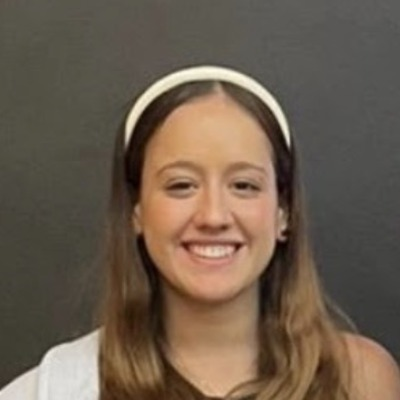

# Maria Heloísa Prado

**Engenharia Aeroespacial & Engenharia de Dados · UFABC**

Santo André, São Paulo

---

## 👋 Sobre mim

Sou estudante de Engenharia Aeroespacial e de Engenharia de Dados na Universidade Federal do ABC (UFABC), onde também curso o Bacharelado em Ciência e Tecnologia. Construo uma trajetória interdisciplinar entre engenharia, tecnologia, análise de dados e impacto social.

Sou movida pela busca por conhecimento e inovação. Já atuei em ambientes corporativos como Mercedes-Benz Brasil, Shopper.com.br e Red Bull, e em pesquisa científica: da física de partículas, estudando o bóson W, à investigação da construção social de meninas nas áreas STEAM. Sou proativa e orientada a resultados, com facilidade para liderar, me comunicar e melhorar processos.

Fora da sala de aula, fundei o **Instituto Mello**, que aproxima jovens de simulações da ONU, aulas de inglês e mentorias, e atuo no **TecMeninas ABC**, levando programação e letramento digital a meninas de escolas públicas. Busco unir conhecimento técnico e colaboração para criar soluções que resolvam problemas concretos e ampliem oportunidades.

## 🚀 O que estou fazendo

- **Engenharia Aeroespacial & de Dados:** cursando os bacharelados na UFABC, no período noturno, com formação prevista para 2028.
- **Pesquisa no TecMeninas ABC:** como pesquisadora científica, apoio atividades de programação e letramento digital para estudantes de escolas públicas, incentivando meninas em STEM.
- **Embaixadora Google Gemini:** exploro ferramentas de IA, compartilho boas práticas e incentivo o uso da inteligência artificial na aprendizagem, na produtividade e na resolução de problemas.
- **Estratégia, Dados & Mercado Financeiro:** aprofundo análise de dados, construção de indicadores e gestão de negócios, com formações em finanças pelo Fin4She, Dn'A Women e ESPM.

## 🏆 Destaques

| | |
|---|---|
| 🥇 **1º lugar · IREC 2025** | Categoria 10k SRAD Solid, com a equipe Rocket Design UFABC |
| 🥇 **1º lugar · SharkTank** | Semana do Produto Itaú Unibanco, proposta destaque em inovação e visão estratégica |
| 🎖️ **Menção Honrosa · Yale MUN 2024** | Conquistada pela equipe do Instituto Mello, que liderei e orientei como mentora |
| 👩‍💻 **185 meninas** | Alcançadas pelo TecMeninas ABC em 2026, em 6 escolas de 3 cidades do Grande ABC |

---

## 🎓 Formação

### Universidade Federal do ABC (UFABC)
*Formação prevista: 11/2027 (BC&T) · 11/2028 (Engenharias)*

- **Bacharelado em Ciência e Tecnologia:** 10º quadrimestre (noturno), formação prevista em 11/2027.
- **Bacharelado em Engenharia Aeroespacial:** 8º quadrimestre (noturno), formação prevista em 11/2028.
- **Bacharelado em Engenharia de Dados:** 8º quadrimestre (noturno), formação prevista em 11/2028.
- **Desempenho:** conceito A em Bases Computacionais da Ciência e em Processamento da Informação.

### Formação técnica em Mecatrônica · SENAI

### SESI · Ensino Médio
Bolsa integral por mérito acadêmico. Participação nos projetos de robótica do SESI (Sorobóticos).

## 💼 Experiência

### Pesquisadora Científica, Projeto TecMeninas ABC (UFABC)
*Fev 2026 — Atual*

Atuação em iniciativas de ensino, extensão e popularização da ciência.

- **Programação e letramento digital:** apoio ao desenvolvimento de atividades para estudantes de escolas públicas, contribuindo para democratizar o acesso à tecnologia e incentivar meninas e jovens em áreas STEM.
- **Comunicação:** apoio à presença digital do projeto, incluindo Instagram e site.
- **Impacto:** em 2026, o projeto alcançou 185 meninas em 6 escolas de 3 cidades do Grande ABC.

### Estagiária de Marketing | Embaixadora Red Bull na UFABC, Red Bull
*Fev 2026 — Out 2026*

Desenvolvimento de projetos de Hacks, seeding e sampling, principalmente dentro da UFABC, e atuação em eventos externos com o objetivo de levar o consumo funcional ao público EPC.

### Estagiária de Negociação, Shopper.com.br
*Ago 2025 — Jan 2026 (6 meses)*

- **Negociação com fornecedores:** contato direto para negociação de custos e aderência de novos SKUs, buscando os melhores valores de venda e a melhora do sell-out da empresa.
- **Pet.Shopper:** responsável pelo mix de SKUs, negociação de reajustes de preço, rentabilidade e revisão de sortimentos.

### Estagiária de Engenharia, Mercedes-Benz Brasil
*Set 2024 — Jul 2025 (11 meses)*

Atuação na interface entre engenharia e análise de dados, com foco em automação de processos, rastreabilidade técnica e suporte à tomada de decisão.

- **Dados e BI:** desenvolvimento de dashboards em Power BI e Excel.
- **Projeto AUB Tractor:** coordenação do fluxo de amostras e contribuição em testes e validações técnicas.
- **Qualidade de fornecedores:** avaliação por meio de ICAs e OSAs, promovendo melhorias contínuas e alinhamento com padrões de qualidade.
- **Inovação:** concepção da plataforma interna de troca de conhecimentos "Faça sua estrela brilhar".

### Pesquisadora Científica, UFABC
*2024 — 2025*

- Estudo da produção e reconstrução do bóson W em colisões de altas energias.
- Geração de eventos Monte Carlo e análise de dados em colaboração com o SPRACE.

## 🤝 Liderança e voluntariado

- **Fundadora, Instituto Mello:** lidero simulações de MUN e debates para educação política; a iniciativa evoluiu para aulas de inglês e mentorias. No Yale MUN 2024, liderei a equipe do instituto como mentora e guia dos alunos, e a equipe conquistou Menção Honrosa.
- **Embaixadora Google Gemini (2026):** uso da inteligência artificial no ambiente acadêmico: exploração de ferramentas, compartilhamento de boas práticas e incentivo à aplicação da IA.
- **Past-President, Rotary Club:** gestão de projetos comunitários, palestras, eventos e desenvolvimento profissional.
- **Líder de Projetos e Inovação, Girl Up (ONU):** atuação na interface com empresas parceiras e eventos, além de design e marketing digital.
- **Jovem Líder, Garotas na Ciência (ONU):** participação como jovem líder em eventos na área STEAM.
- **Parceira, Podemos:** apoio ao desenvolvimento de jovens para olimpíadas de conhecimento.
- **Voluntária, Hamburgada do Bem e Nossa Casinha:** evento beneficente de apoio a causas sociais e ensino de português para refugiados.

## 🌟 Programas e imersões

- **She++ | Uber** (São Paulo, junho de 2025): programa altamente seletivo da Uber que conecta jovens mulheres de destaque em tecnologia e engenharia a líderes da empresa, com mentorias, workshops e imersão em desafios reais do setor.
- **Dn'A Women** (certificado ESPM · Introdução ao Mercado Financeiro): programa internacional de desenvolvimento de universitárias de alto potencial, criado por líderes de bancos como UBS e Goldman Sachs.
- **Fin4She** (Young Women Summit 2025 · 100 horas): capacitação feminina no mercado financeiro, com mentorias de executivas e preparação para certificações ANBIMA.
- **Hackathon de AI e Multi-Cloud:** competição do Itaú com foco em soluções de IA, dados e nuvem para desafios reais do setor financeiro.
- **Bootcamp Locke:** imersão seletiva em filosofia, política e inovação para a formação de jovens líderes.
- **Uber Global Hacktown:** programa global com foco em design de produto e análise de dados.
- **Green Team Hacker Club:** programação e proteção de dados.
- **GitHub Copilot Day:** evento sobre o uso de ferramentas de IA no desenvolvimento de software.
- **Google Cloud Summit Brasil:** evento do Google Cloud sobre nuvem, dados e inteligência artificial.
- **B3 Career Summit:** imersão em liderança e carreira no mercado financeiro.

---

## 🛰️ Projetos

### Engenharia

| Projeto | Descrição |
|---|---|
| **Rocket Design UFABC** | Atuação na frente de extensão da equipe de foguetes: workshops de Ciência e Tecnologia em escolas e universidades, aproximando estudantes de astronomia e engenharia aeroespacial, além do desenvolvimento de protótipos. Em 2025, a equipe conquistou o **1º lugar no IREC, categoria 10k SRAD Solid** (foguetes com apogeu-alvo de 10 mil pés e motor sólido projetado e desenvolvido pelos próprios estudantes). |
| **Faça Sua Estrela Brilhar** | Plataforma interna de troca de conhecimentos concebida durante o estágio na Mercedes-Benz Brasil para aproximar colaboradores de áreas diferentes. Cada pessoa cadastra o que quer aprender e o que pode ensinar; aprendizados comprovados presencialmente rendem estrelas, resgatáveis por produtos na loja de colaboradores. Desenvolvida com HTML, CSS e JavaScript. |
| **Soluções para Desafios em Engenharia** | Projeto acadêmico da UFABC em que desenvolvi a estrutura inicial do site do grupo (interface, código e funcionalidades), base sobre a qual os demais integrantes fizeram aprimoramentos. |

### Pesquisa

| Projeto | Descrição |
|---|---|
| **Física de Partículas: Bóson W** | Pesquisa científica na UFABC (2024–2025) sobre a produção e a reconstrução do bóson W em colisões de altas energias, com geração de eventos Monte Carlo e análise de dados em colaboração com o SPRACE. Complementada pelas International Masterclasses on Particle Physics (IA e LaTeX). |
| **Meninas em STEAM (CNPq)** | Iniciação Científica com bolsa do CNPq, voltada à análise de dados e à investigação da construção social de meninas nas áreas STEAM: participação e representação, fatores sociais e culturais, e uso de dados para compreender fenômenos de educação e participação. |
| **Citizen Scientist NASA & MCTI** | Ciência cidadã na campanha Caça Asteroides: análise de sequências de imagens de telescópio em busca de objetos em movimento, além de outras iniciativas científicas ligadas à astronomia. |

### Impacto

| Projeto | Descrição |
|---|---|
| **TecMeninas ABC** | Projeto de extensão da UFABC que leva programação e letramento digital a meninas de escolas públicas. Em 2025, ações nas escolas Adamastor e Nadir; em 2026, **185 meninas em 6 escolas de 3 cidades do Grande ABC**, incluindo Mauá e São Bernardo do Campo. |
| **Instituto Mello** | Iniciativa que fundei para ampliar o acesso de jovens a simulações da ONU (MUN) e que evoluiu para debates de educação política, aulas de inglês e mentorias. Menção Honrosa no Yale MUN 2024. |
| **Embaixadora Google Gemini** | Embaixadora estudantil em 2026, incentivando o uso de IA no ambiente acadêmico. Também participei do GitHub Copilot Day e do Google Cloud Summit Brasil e conquistei o badge Google Cloud de BigQuery & AI. |

#### Alcance do TecMeninas ABC em 2026

| Escola | Meninas | Cidade |
|---|---:|---|
| Adamastor | 16 | |
| Nadir | 29 | |
| Jardim Zaira | 35 | Mauá |
| Santa Olímpia | 35 | São Bernardo do Campo |
| José Gonçalves | 35 | São Bernardo do Campo |
| Irene da Silva Costa | 35 | Mauá |
| **Total** | **185** | **6 escolas · 3 cidades do Grande ABC** |

---

## 🛠️ Competências

| Área | Tecnologias e habilidades |
|---|---|
| **Programação** | Python · C++ · MATLAB · HTML · CSS · JavaScript · VBA |
| **Dados & BI** | Power BI avançado · Excel · SQL Server no Excel · BigQuery |
| **Cloud & Automação** | Microsoft Office · Azure · Google Cloud · Power Automate |
| **Inteligência Artificial** | Google Gemini · ChatGPT · Claude · GitHub Copilot |
| **Documentação & Design** | LaTeX · Canva |
| **Comportamentais** | Comunicação assertiva · Liderança de equipes multidisciplinares · Resolução de problemas · Pensamento analítico · Proatividade · Adaptabilidade |

  
  
  
  
  
  
  
  
  
  
  
  
  

## 📜 Cursos e certificações

- **Power BI Avançado:** Daimler Truck
- **BigQuery & AI:** badge Google Cloud
- **Databases e AI:** Google
- **Inteligência Artificial e Produtividade:** Google e Santander
- **Masterclasses on Particle Physics:** International Masterclasses (IA & LaTeX)
- **Meninas Programadoras:** USP (Python)
- **Maratona de Programação Feminina:** Python & C++
- **Uber Global Hacktown:** design de produto e análise de dados
- **SQL Server no Excel & VBA:** LinkedIn Learning
- **Introdução ao Mercado Financeiro:** ESPM
- **Economia Circular:** inpEV
- **Workshops de Escrita:** Harvard Crimson
- **Representação Técnica UFABC:** feiras e eventos, incluindo a Semana das Engenharias

## 🌐 Idiomas

| Idioma | Nível |
|---|---|
| Português | Nativo |
| Inglês | B2 |
| Espanhol | A2 |
| Italiano | A1 |

*Níveis segundo o Quadro Europeu Comum de Referência (A1 a C2).*

---

📫 **Vamos conversar?** [mariaheloprado@gmail.com](mailto:mariaheloprado@gmail.com) · [LinkedIn](https://www.linkedin.com/in/MariaHeloPrado) · [Lattes](https://shre.ink/LN6v)

